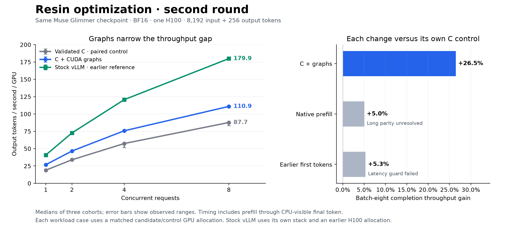

# Muse Glimmer inference on Resin

This repository investigates how quickly agents can bring up and optimize a
model-specific inference runner using Resin's scheduler, request lifecycle, and
KV-cache infrastructure. The model is Muse Glimmer 30B on one H100 in BF16.

`main` contains the best validated composition: **C's native paged decode plus
stateless CUDA graph regions**, originally qualified at
[`6fd2dda`](https://github.com/r-chong/resin-muse-glimmer/commit/6fd2dda4b0677bea4e539135f016c6b40a5c8653).
Resin owns the KV pages; FlashInfer consumes them directly during one-token
decode. Graphs cover projection/RoPE and feed-forward regions. Prefill retains
the validated PyTorch SDPA path. The scheduler and model precision are unchanged.

## Measured result

The promoted composition reached **110.9 output tok/s/GPU at batch eight**, versus
87.7 for its paired C control: **+26.5%**. Mean per-request time per output token
fell from 58.8 to 39.6 ms. All generated tokens matched the control across the
three-repeat synthetic completion benchmark, and the saved-reference,
window/chunk, concurrency, and affected graph/cache checks passed.

These are submit-to-final-CPU-visible-token results, including prefill, for
8,192 input tokens and 256 output tokens per request. They exclude HTTP and
detokenization. Each entry is the median of three cohorts.

| Concurrent requests | Paired C control, tok/s/GPU | Promoted C + graphs, tok/s/GPU | Stock vLLM reference, tok/s/GPU |
|---:|---:|---:|---:|
| 1 | 18.93 | 26.83 | 40.83 |
| 2 | 33.93 | 46.60 | 72.65 |
| 4 | 57.38 | 75.76 | 120.68 |
| 8 | 87.70 | 110.91 | 179.88 |

The promoted implementation reaches **61.7% of the stock-vLLM reference** at
batch eight. The two Resin columns share a physical H100 allocation. Stock
vLLM 0.34.0 used the same checkpoint, tokens, BF16 precision, GPU type, and
completion boundary, but its own pinned dependency stack and a separate,
earlier allocation. This is a reference comparison, not a claim of overall
competitiveness or dataset-level output quality.



## Optimization decisions

The performance gate required at least 10% more aggregate batch-eight throughput
with at most 5% latency regression on the checked curve, plus correctness checks.
Internal decode windows exclude prefill; completion measurements include it.
Compare each candidate with its own paired control, not absolute values across
different allocations. These two measurement boundaries are not interchangeable.

| Optimization | Hypothesis | Measured outcome at batch eight | Accepted or rejected for `main` |
|---|---|---|---|
| A2: trim unreadable sliding pages and reuse mask metadata | Reduce repeated PyTorch KV and row work | Internal decode 57.9 → 97.8 tok/s/GPU, **+68.8%**; correctness/latency gate passed | **Not accepted into the final composition**: successful standalone experiment; combining it with C + graphs was not validated |
| B: stateless graph regions on the original runner | Reduce host dispatch overhead | Internal decode 58.0 → 58.4, **+0.7%**; below aggregate-throughput gate | **Rejected standalone**; graph mechanism was retested on C |
| C: consume Engine-managed pages directly with FlashInfer | Remove dense KV gathers and GQA expansion during decode | Internal decode 58.2 → 154.5, **+165.4%**; correctness/latency gate passed | **Accepted**, foundation of the promoted runner |
| C + graphs | Graph overhead matters more after native attention removes KV materialization | Completion 87.7 → 110.9, **+26.5%**; mean TPOT 58.8 → 39.6 ms; exact benchmark token agreement | **Accepted**, promoted composition |
| Native prefill on C | Use existing pages directly for multi-token attention | Completion 66.6 → 69.9, **+5.0%**; 8K prefill time down 13%; saved references passed but long synthetic sequences diverged | **Rejected from `main` / provisional**: below throughput gate and strict long-sequence parity unresolved |
| Earlier first-token delivery | Publish completed prefills through the existing token budget | Completion 79.6 → 83.9, **+5.3%**; worst per-request mean TPOT rose **34.6%**, maximum first-to-second-token gap about **7.4 s** | **Rejected**: latency guard failed |

Native-prefill diagnostics found an exact top-logit tie at the first divergence
under identical forced context. This supports numerical sensitivity as the
immediate mechanism, but does not prove harmlessness or full correctness.
Independent extended HF validation and dataset-level quality remain unmeasured.
The rejected candidates are not enabled in the promoted implementation.

Evidence: [first round](results/optimization/parallel-20261119/analysis.json),
[second round](results/optimization/round2-20261119/analysis.json),
[numeric diagnosis](results/optimization/round2-20261119/shared/numeric-diagnosis.json),
and [SVG for presentations](results/optimization/round2-20261119/throughput.svg).

## Reproduce the validated configuration

Follow [REPRODUCE.md](REPRODUCE.md) for dependencies, checkpoint/reference volumes,
and the full protocol. After setup, prepare immutable sources locally:

```bash
resin-source/.venv/bin/python harness/optimization/prepare_validated.py \
  --directory /tmp/resin-validated-replay
```

Then run qualification and the paired completion benchmark on one billed H100:

```bash
resin-source/.venv/bin/python harness/optimization/round2_modal.py \
  --spec /tmp/resin-validated-replay/spec.json \
  --output /tmp/resin-validated-replay/run \
  --job-id "validated-$(date -u +%Y%m%dT%H%M%SZ)" --timeout 1200
```

The spec explicitly sets `RESIN_MUSE_DECODE_EXECUTION=graphs` for the candidate,
and the benchmark calls `capture_cuda_graphs()` before timing. Direct runner
users select `decode_execution="graphs"` and call `capture_cuda_graphs()` before
driving the Engine. Graph mode is opt-in; constructing the runner without that
argument or environment variable keeps eager dispatch. The validated graph
batch catalog is 1/2/4/8.

## Branch hypotheses and preserved baseline

Branches remain independent records of their hypotheses; names are retained so
existing commit references and benchmark records remain traceable.

| Branch | Role / hypothesis |
|---|---|
| [`codex/resin-opt-a`](https://github.com/r-chong/resin-muse-glimmer/tree/codex/resin-opt-a) | A: reduce PyTorch KV-copy, mask, and row overhead |
| [`codex/resin-opt-b`](https://github.com/r-chong/resin-muse-glimmer/tree/codex/resin-opt-b) | B: stateless CUDA graph regions on the original runner |
| [`codex/resin-opt-c`](https://github.com/r-chong/resin-muse-glimmer/tree/codex/resin-opt-c) | C: native attention over Resin-managed paged KV |
| [`codex/resin-benchmark-d`](https://github.com/r-chong/resin-muse-glimmer/tree/codex/resin-benchmark-d) | D: independent qualification, paired measurement, and stock vLLM reference |
| [`codex/resin-round2-graphs`](https://github.com/r-chong/resin-muse-glimmer/tree/codex/resin-round2-graphs) | C + B: validated graph/native-attention composition promoted to main |
| [`codex/resin-round2-prefill`](https://github.com/r-chong/resin-muse-glimmer/tree/codex/resin-round2-prefill) | Native multi-token prefill; provisional, not promoted |
| [`codex/resin-round2-delivery`](https://github.com/r-chong/resin-muse-glimmer/tree/codex/resin-round2-delivery) | Earlier prefill publication; rejected latency tradeoff |
| [`codex/resin-round2-bench`](https://github.com/r-chong/resin-muse-glimmer/tree/codex/resin-round2-bench) | Shared second-round measurement and diagnostic tooling |

The original frozen baseline is tagged
[`baseline/frozen-20261119`](https://github.com/r-chong/resin-muse-glimmer/tree/baseline/frozen-20261119)
at `73532b9aa69f15d91b232dc47191c6a2cf077dbd`.
The pre-promotion main backup is tagged
[`backup/main-before-optimized-runner-20261120`](https://github.com/r-chong/resin-muse-glimmer/tree/backup/main-before-optimized-runner-20261120)
at `cbf5dc9a6b9d77f2270786f1ef7576b2ce1d7bab`.

Raw archives, profiler traces, console logs, and logit arrays stay local or on
the recorded Modal volumes. See [artifact storage](results/optimization/artifact-storage.json)
and the [history map](results/optimization/history-rewrite-map.json). No LFS is required.
